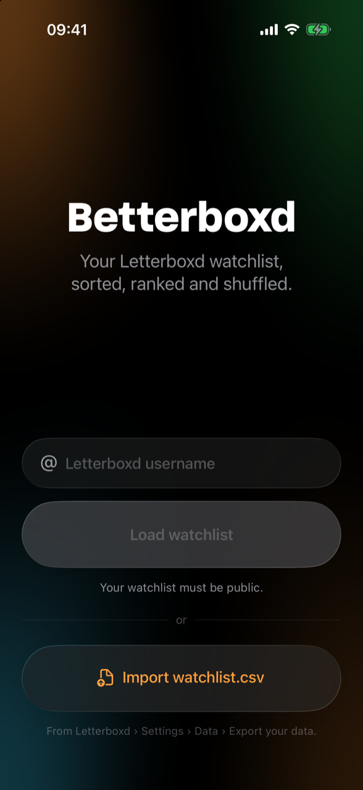
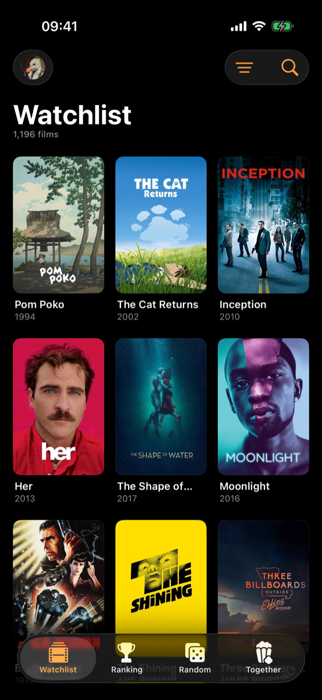
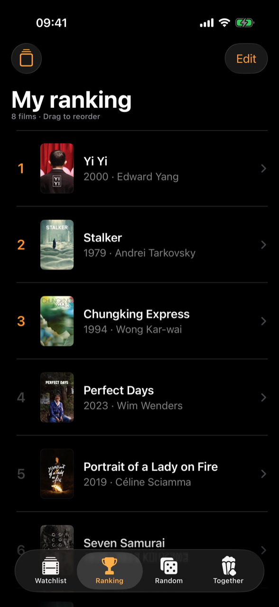
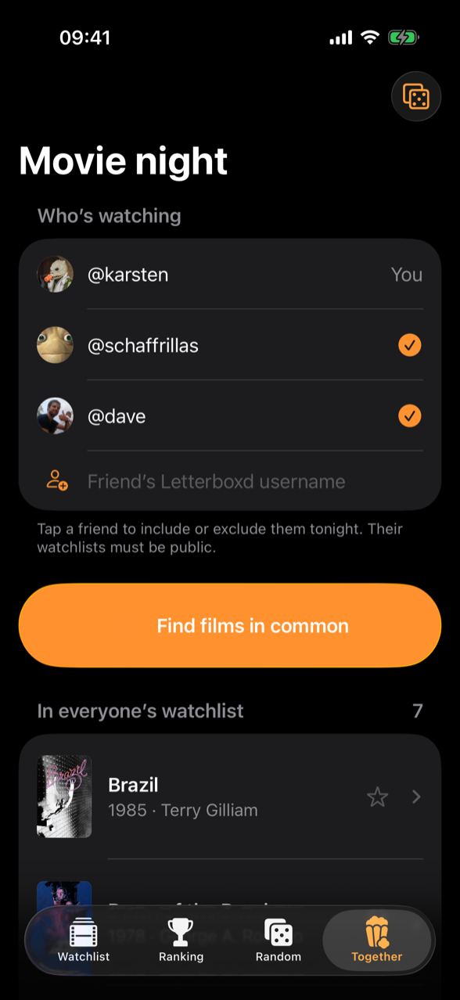
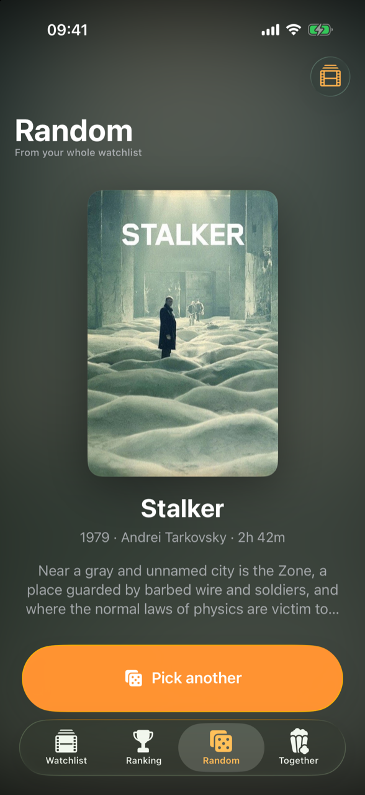
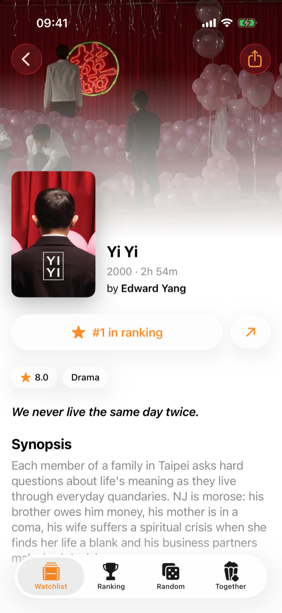
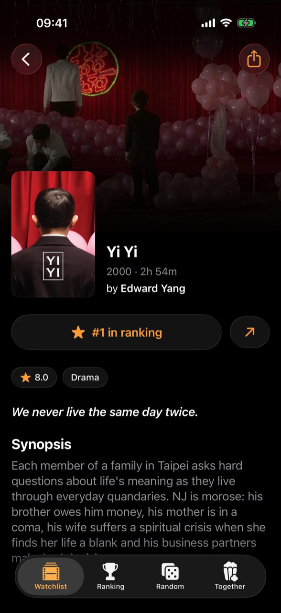

<p align="center">
  
</p>

<h1 align="center">Betterboxd</h1>

<p align="center">
  An iOS app for your <a href="https://letterboxd.com">Letterboxd</a> watchlist: enter your username to browse it, sort it, build your own rankings of films to watch, find the films you have in common with friends and let chance pick tonight's movie.
</p>

<p align="center">
  
  
  
  
</p>
<p align="center">
  
  
  
</p>

## Features

- **Watchlist from your username.** Enter your Letterboxd username (or `@name`, or your profile link) and the app downloads your whole watchlist. It refreshes on its own when you reopen the app, or when you pull down on the list.
- **Grid or list**, with five sort orders: recently added, first added, release date (newest or oldest first) and title.
- **Multiple rankings.** Create as many lists as you like (for example "With friends" or "Date night"), star films to add them and drag them into order.
- **Together.** Add the usernames of one or more friends and see which films you all have in your watchlists, which makes planning a movie night easy. Friends stay saved and each time you pick who's in. With three or more people it also shows the films that almost everyone has. The dice at the top picks one of the shared films at random, with the same animation as Random.
- **Random.** Can't decide what to watch? The app spins through the titles and picks a film from your whole watchlist or from one of your lists.
- **Film details**: poster, backdrop, director, runtime, genres, rating and synopsis in the app's language (in English when no translation is available).
- **Search** by title or year, from the magnifying glass at the top of the Watchlist.
- **Hide** films you're no longer interested in; you can restore them in Settings.
- **CSV import** as an alternative to your username.

The app is available in **English and Italian** and follows the system language. It uses the native iOS 26 look, with Liquid Glass on the tab bar, toolbars and buttons, and supports dark mode. The tab bar shrinks as you scroll down and comes back as soon as you scroll up.

## How it reads your watchlist

Letterboxd has an API, but it isn't public: access must be requested and is rarely granted. Betterboxd therefore reads the public watchlist page (`letterboxd.com/<username>/watchlist/`), the same one you see in a browser. This has two consequences:

- **Your watchlist must be public**, and so must your friends' in Together.
- **If Letterboxd changes the structure of its pages** or blocks requests, loading by username may stop working until the app is updated.

In that case you can use the CSV file: on Letterboxd go to **Settings › Data › Export your data**, unzip the archive and import `watchlist.csv` from the app.

Rankings and hidden films are stored on your phone and are kept when you switch between CSV and username.

## Requirements

- Xcode 26 or later
- iOS 26 or later
- A free [TMDb](https://www.themoviedb.org) API key, for posters and film details

## Installation

1. Clone the repository:
   ```sh
   git clone https://github.com/dsaldamarco/Betterboxd.git
   cd Betterboxd
   ```
2. Create the file for your TMDb key from the example:
   ```sh
   cp Secrets.example.xcconfig Secrets.xcconfig
   ```
   Open `Secrets.xcconfig` and paste your key in place of `INCOLLA_QUI_LA_TUA_CHIAVE`. You'll find it on TMDb under **Settings › API**: it's the 32-character "API Key", not the access token. The file is ignored by git, so your key never ends up in the repository.
3. Open `Smarterboxd.xcodeproj` in Xcode and run the app.

Without a key the app still works, but without posters or film details.

## Project structure

| File | Contents |
| --- | --- |
| `LetterboxdService.swift` | Downloads and parses the watchlist pages |
| `CSVParser.swift` | Reads the `watchlist.csv` exported from Letterboxd |
| `TMDbService.swift` | Posters and details from TMDb, cached on the device |
| `WatchlistStore.swift` | App state: films, rankings, hidden films, account |
| `MovieNightView.swift` | Together: compares the watchlists of several people |
| `ShuffleView.swift` | Animated random pick, used by Random and Together |
| `Localizable.xcstrings` | App strings in English and Italian |
| `*View.swift` | The other SwiftUI screens |

## Credits

This product uses the TMDb API but is not endorsed or certified by TMDb.

Betterboxd is an independent project and is not affiliated with Letterboxd.

## License

Released under the [MIT](LICENSE) license.
